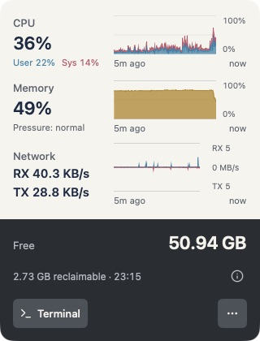
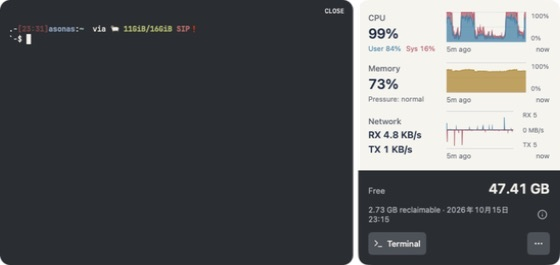

# puipui

A native macOS menu bar app for checking system activity and opening a terminal without leaving the dashboard.

puipui combines five minutes of CPU, memory, and network history with free disk space and a cleanup estimate from [Mole](https://github.com/tw93/Mole). An embedded [Ghostty](https://github.com/Lakr233/libghostty-spm) terminal provides a place to run `mo` or other shell commands.

<p>
  
  
</p>

## What it does

- Samples CPU, memory, and the primary network interface every second, with a five-minute history. CPU separates User and System; network traffic separates receive and send.
- Refreshes free disk space about once a minute. Runs `mo clean --dry-run` at launch, then schedules the next scan one hour after each scan completes.
- Opens an interactive login shell in a terminal drawer. Hiding the drawer preserves the session; closing it ends the shell.
- Detaches into a window when dragged by its top handle. The app stays out of the Dock.

The background scan estimates reclaimable space; it does not delete cleanup candidates. Mole does write its preview file and operation logs. Cleanup commands are entered and run manually in the terminal.

## Install

Download the Apple Silicon DMG from [GitHub Releases](https://github.com/asonas/puipui/releases), open it, and drag **puipui** to **Applications**. Quit any running copy before replacing it, then launch `/Applications/puipui.app`. Release builds are Developer ID signed and notarized by Apple.

Install [Mole](https://github.com/tw93/Mole) separately to enable cleanup estimates. System metrics and the terminal work without it.

## Build from source

The package targets macOS 13 or later and requires an Xcode toolchain with Swift 6. The current build has been verified on Apple Silicon with Swift 6.4.

The build script defaults to the maintainer's Apple Development identity. On another machine, set `CODE_SIGN_IDENTITY` to a certificate in your keychain. Signing failures stop the build. Local development builds are not notarized; [release builds](docs/releases.md) use Developer ID signing and Apple notarization.

```sh
git clone https://github.com/asonas/puipui.git
cd puipui
export DEVELOPER_DIR=/Applications/Xcode.app/Contents/Developer
sh scripts/build-app.sh
open build/puipui.app
```

## Using puipui

Click the guinea pig in the menu bar to open the dashboard. Drag the handle at the top to detach it; after closing the detached window, click the menu bar icon to reopen the panel.

| Control | Behavior |
| --- | --- |
| **Terminal** | Opens or hides the terminal drawer. The shell starts in the home directory and loads the account's interactive login configuration. |
| **CLOSE** in the drawer | Ends the terminal session. Quitting the app also terminates and reaps its shell. |
| **… → Scan** | Runs another dry-run and resets the next scan time. Disabled while a scan is running. |
| **… → Check for Updates…** | Checks the GitHub Releases feed using Sparkle and offers available updates. Automatic checks use Sparkle's consent prompt. |
| **Information icon** | Shows the last successful scan, next scan, Mole executable path, and any failure. Click outside or press Esc to dismiss. |
| **… → Quit puipui** | Exits the app. |

Missing readings appear as `—`, and missing history stays blank. A failed scan preserves the last successful estimate and timestamp, marked **Update failed**. Scan results are held in memory until the app quits. After running a cleanup command, choose **Scan** to refresh the estimate; puipui does not monitor terminal commands for completion.

## Development and design

See [Development](docs/development.md) for the source layout, metric semantics, and verification commands.
See [Releases](docs/releases.md) for signed DMG packaging and Sparkle publishing.

The app icon is an original resting guinea pig: **C / resting loaf** in the [Figma design](https://www.figma.com/design/spwA1eEgycGIK1TtjHZ45R/puipui?node-id=27-134). The app name is always written **puipui**. The symbol follows Lucide's 24px canvas and 2px rounded-stroke vocabulary; the rounded app background is a separate layer.

- [App icon SVG](Resources/AppIcon.svg) and [macOS ICNS](Resources/AppIcon.icns)
- [Monochrome symbol](Resources/AppIconConcepts/guinea-pig-c.svg), also used as a template image in the menu bar
- [Icon studies](Resources/AppIconConcepts/README.md) and [design decisions](docs/design-refinement.md) (Japanese)

The interface uses [Lucide icons](https://lucide.dev), with their [license included](Sources/Puipui/Resources/Icons/LICENSE). The original guinea pig symbol is separate from the Lucide icon set.

## License

Licensed under the [MIT License](LICENSE). Copyright (c) 2026 Yuya Fujiwara.

Third-party components retain their own licenses. Their [notices](Resources/ThirdPartyNotices.txt) are included in the app bundle alongside puipui's license.
Releases also include [corresponding source and rebuilding instructions](docs/third-party-sources.md).
